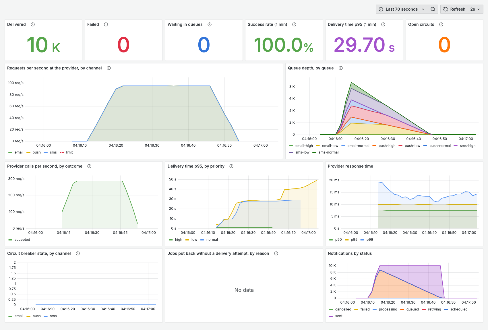
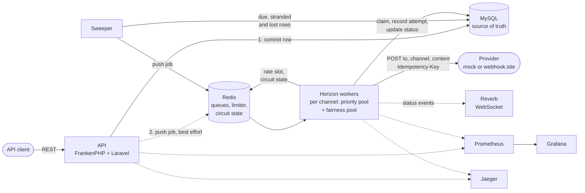
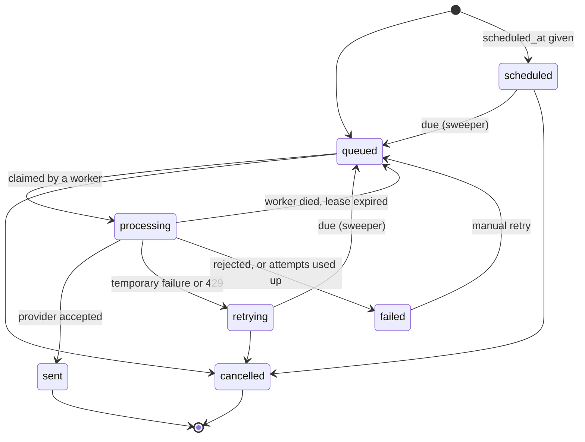

# Event-Driven Notification System

Accepts notifications for SMS, email and push over a REST API, queues them, and
delivers them through an external provider at a controlled rate, with
priorities, retries, idempotency, scheduling and real-time status.

Built with Laravel 13 (PHP 8.4), MySQL 8.4, Redis 7 and Horizon for the
Insider One Software Engineer Assessment.

```bash
docker compose up -d --build     # everything; the API is on http://localhost:8080
```

## Measured, not claimed

Every guarantee below was measured on the running stack by `make demo`, which
drives the system through its public API, makes the provider misbehave, and
then counts what the provider actually received. Raw output is in
[`docs/results`](docs/results).

| Scenario | What happens | What was measured |
|---|---|---|
| `burst` | 10,000 notifications across three channels, accepted by the API in 4.3 s | **10,000 delivered, 0 failed**, each on its first attempt. The provider counted at most **97 requests in any one second** per channel (limit 100). Median time to delivery: high 0.6 s, normal 9.3 s, low 22.9 s. |
| `burst`, twice the workers | The same burst with 10 worker processes per channel instead of 5 | Still at most **98 per second** per channel, and still 0 failed: the limit is global, not per worker. |
| `flaky` | The provider fails 30 % of all requests | **896 of 900 delivered** through retries. The other 4 used all 5 attempts and are marked failed with the reason. |
| `lost-response` | The provider accepts messages but loses 10 % of its responses | 600 of 600 ended as sent. **63 messages were sent a second time and none was delivered twice**: the provider recognised them by their idempotency key. |
| `throttle` | The provider answers 429 with `Retry-After` for 6 s | **14 requests** were answered with 429; without a channel-wide pause it would be about 600. All 800 delivered on their first attempt. |
| `outage` | The provider is down for 12 s | **24 requests** went into the outage before the circuit opened; without a breaker about 1,200. 900 of 900 delivered afterwards, none failed. |
| `crash` | 5 worker processes killed with SIGKILL while their request was in flight | **10 of 10 delivered, 10 unique deliveries** at the provider; the 5 resends were recognised. Recovered in 35 s (30 s lease plus grace). |
| `cancel` | A batch of 1,000 cancelled while it was being delivered | 829 cancelled. The provider received **exactly the 171** that were not. |
| `idempotency` | The same request with the same key, 30 times at the same moment | One `201`, 29 replays with `200`, **one row, one delivery**. |
| `schedule` | 200 notifications scheduled 6 s ahead | None sent early. 95 % delivered within 3.0 s of the scheduled time. |

Measured with Docker on a 12-core laptop: 5 worker processes per channel (4 priority, 1 fairness), the mock
provider answering in about 5 ms. Numbers vary slightly between runs; the
checks (`at most 100`, `0 failed`, `exactly once`) do not.



*The provisioned Grafana dashboard during the burst. Top left: requests per
second as counted by the provider, flat just under the dashed limit while
10,000 notifications wait (the three channels overlap). Top right: the nine
queues, high priority draining first.*

## Contents

- [Quick start](#quick-start)
- [Requirements coverage](#requirements-coverage)
- [Architecture](#architecture)
- [The hard parts](#the-hard-parts)
- [API examples](#api-examples)
- [Observability](#observability)
- [Testing](#testing)
- [Design decisions](#design-decisions)
- [Known limitations and next steps](#known-limitations-and-next-steps)
- [How this was built](#how-this-was-built)

## Quick start

Requirements: Docker with Compose. Nothing else; no PHP on the host, no `.env`
to create, no manual migration.

```bash
git clone <this repository> && cd <directory>
docker compose up -d --build
```

| What | Where |
|---|---|
| REST API | http://localhost:8080/api/v1 |
| API documentation (Swagger UI) | http://localhost:8081 |
| Grafana dashboard (no login) | http://localhost:3000 |
| Live status stream (WebSocket) | http://localhost:8080/live |
| Traces (Jaeger) | http://localhost:16686 |
| Queue dashboard (Horizon) | http://localhost:8080/horizon |
| Prometheus | http://localhost:9090 |
| Mock provider statistics | http://localhost:9000/__admin/stats |

Send a notification and follow it:

```bash
curl -s -X POST http://localhost:8080/api/v1/notifications \
  -H 'Content-Type: application/json' \
  -d '{"channel":"sms","recipient":"+905551234567","content":"Your code is 482913","priority":"high"}'

curl -s http://localhost:8080/api/v1/notifications/<id>     # status, attempts, provider message id
```

Useful commands:

```bash
make test         # the whole test suite, against real MySQL and Redis
make lint         # Pint, Larastan (level max), Rector
make demo         # run all scenarios and print the measurements (about 6 minutes)
make scenario name=burst
make logs         # structured JSON logs of API, workers and sweeper
make down         # stop and remove volumes
```

### The provider: mock by default, webhook.site by one setting

The brief asks to simulate the provider with webhook.site. The delivery client
implements exactly that contract (`POST {to, channel, content}` →
`202 {messageId, status, timestamp}`), so it works against a webhook.site URL
unchanged:

```bash
# docker/app.env
NOTIFICATION_PROVIDER_URL=https://webhook.site/<your-uuid>
```

```bash
docker compose up -d      # picks up the new URL
```

On webhook.site, set the response to status `202` with the JSON body from the
brief so that `provider_message_id` is filled in.

The default, however, is a **bundled mock provider** that implements the same
contract. Two reasons:

- A free webhook.site URL accepts **100 requests** and is deleted after
  7 days. A load test would stop at request 101, and a URL committed to this
  repository would be dead by the time it is reviewed.
- Guarantees about rate, retries and duplicates can only be proven against a
  provider that can fail on demand and that counts what it receives. The mock
  injects 5xx errors, 429s, outages, slow and lost responses, honours the
  `Idempotency-Key` header as real providers do, and records every arrival
  with its timestamp ([`mock-provider/index.php`](mock-provider/index.php)).

## Requirements coverage

| Requirement | Where | Notes |
|---|---|---|
| Create with recipient, channel, content, priority | `POST /notifications` | Per-channel validation |
| Batch creation, up to 1000 | `POST /notifications/batch` | All or nothing, errors reported per index, one bulk insert |
| Status by ID or batch ID | `GET /notifications/{id}`, `GET /batches/{id}` | Notification includes every delivery attempt |
| Cancel pending | `POST /notifications/{id}/cancel`, `POST /batches/{id}/cancel` | A queued job for a cancelled notification is dropped |
| List with filters and pagination | `GET /notifications` | status, channel, priority, batch, date range; cursor pagination |
| Asynchronous processing by queue workers | Horizon, `DeliverNotification` | One queue per channel and priority |
| Rate limit: 100 messages/second/channel | `ChannelRateLimiter` | Global across workers, no window edge; [ADR 3](docs/adr/0003-global-rate-limiter.md) |
| Priority queues | `QueueRouter`, `config/horizon.php` | Strict priority plus a fairness pool; [ADR 6](docs/adr/0006-queues-priority-and-fairness.md) |
| Content validation | `ChannelRules`, `SmsSegments` | SMS limited by segments (GSM-7 vs UCS-2), not by characters |
| Idempotency | `Idempotency-Key` header, claim guard, provider key | Three layers; [ADR 4](docs/adr/0004-delivery-semantics.md) |
| Delivery and retry logic (candidate's design) | `DeliveryHandler`, `RetryPolicy`, `ChannelCircuitBreaker`, `Sweeper` | [ADR 1](docs/adr/0001-database-is-the-source-of-truth.md), [2](docs/adr/0002-delivery-attempts-are-not-queue-attempts.md), [5](docs/adr/0005-retries-and-circuit-breaker.md) |
| Metrics endpoint | `GET /api/v1/metrics`, `GET /metrics` | JSON and Prometheus; queue depth, success/failure rates, latency |
| Structured logging with correlation IDs | `AssignCorrelationId`, JSON logs | The ID follows the notification into the worker |
| Health check | `GET /api/v1/health` | ok / degraded / down, with circuit states |
| Provider integration | `WebhookProvider` | Contract from the brief; mock or webhook.site |
| **Bonus:** failure handling | Circuit breaker, crash recovery, manual retry | Scenarios `outage`, `crash`, `lost-response` |
| **Bonus:** scheduled notifications | `scheduled_at` | Driven from the database by the sweeper |
| **Bonus:** template system | `POST /templates`, `template` + `variables` | Rendered and validated at acceptance |
| **Bonus:** WebSocket updates | Laravel Reverb, `/live` | Every status change is broadcast |
| **Bonus:** distributed tracing | OpenTelemetry → Jaeger | One trace from API request to provider call |
| **Bonus:** GitHub Actions | `.github/workflows/ci.yml` | Pint, Larastan max, Rector, tests on MySQL and Redis |
| Docker Compose, one command | `docker-compose.yml` | Migrations run on start |
| OpenAPI | `docs/openapi.yaml`, Swagger UI on :8081 | Checked against the real API by `ContractTest` |
| Migrations | `database/migrations` | |
| Test suite, one command | `make test` | |

## Architecture



### Life of a notification

1. **Accept.** The API validates the request, stores the row and answers
   `201`. From this moment the notification cannot be lost: the row is the
   source of truth. The job is then pushed to Redis; if that fails the request
   still succeeded and the sweeper pushes it a few seconds later.
2. **Queue.** The job (only the notification id) waits on the queue of its
   channel and priority, for example `sms-high`.
3. **Deliver.** A worker asks the circuit breaker, **claims** the row with a
   conditional `UPDATE` (only one worker can), waits for its rate-limit slot,
   and calls the provider with the notification id as `Idempotency-Key`.
4. **Record.** The call is stored as a delivery attempt and the row moves to
   `sent`, to `retrying` with a due time, or to `failed`.
5. **Recover.** The sweeper puts due retries and scheduled notifications into
   the queue, and takes back rows whose worker died.



Every arrow is a single conditional `UPDATE ... WHERE status IN (...)`, issued
from one class (`NotificationLifecycle`). The caller sees from the affected
row count whether it won, which is what keeps concurrent workers, cancels and
redelivered jobs from stepping on each other.

### Code layout: a modular monolith

```
app/Modules/
  Notifications/   accepting and reading notifications
    Domain/          enums, status rules, SMS segments, channel rules (plain PHP)
    Application/     CreateNotifications, NotificationLifecycle
    Http/            controllers, resources, routes
    Contracts/       ports implemented by other modules
  Delivery/        queue routing, job, handler, rate limiter, retry policy,
                   circuit breaker, provider client, sweeper
  Templates/       templates and rendering
  Observability/   correlation IDs, metrics, health, tracing
  Realtime/        WebSocket broadcast of status changes
app/Scenarios/     demo tooling behind `make demo` (not part of the product)
mock-provider/     stand-in for the external provider (a test double)
```

Module boundaries are enforced by tests
([`tests/Architecture`](tests/Architecture/ModuleBoundariesTest.php)): the
domain uses nothing but PHP, accepting notifications does not know how they
are delivered, and the delivery pipeline never reaches into HTTP.

## The hard parts

The features in the brief are the easy half. These are the places where a
notification system is quietly wrong, and what this one does about each.

**1. Waiting must not look like failing.**
Laravel counts a job attempt every time a job is popped, also when the job
only puts itself back because the rate limit is reached. With a fixed `tries`
and a burst, jobs far back in the queue wait many times and are failed by the
queue although the provider never rejected them. Here the queue allows
unlimited pops and gives up only on real errors; delivery attempts are counted
on the notification. A test with a real worker shows both the pitfall and the
fix. → [ADR 2](docs/adr/0002-delivery-attempts-are-not-queue-attempts.md),
[`QueueAttemptsTest`](tests/Feature/Delivery/QueueAttemptsTest.php)

**2. "100 per second" has to be true at the provider.**
In every one-second window, not just clock-aligned ones, and with any number
of worker processes. A fixed-window counter lets 200 through across a window
edge; a per-process limiter multiplies with the worker count. The limiter here
hands out evenly spaced slots from one shared Redis value per channel.
→ [ADR 3](docs/adr/0003-global-rate-limiter.md)

**3. Sent, but not recorded.**
A worker can die, or a response can be lost, after the provider took the
message. The sender cannot tell this from "not delivered". The system sends
again, and uses the notification id as idempotency key so the provider can
recognise the repeat. → [ADR 4](docs/adr/0004-delivery-semantics.md)

**4. Two systems, no transaction.**
The row is in MySQL, the job in Redis. Whichever is written second can be
lost in a crash. The row is the source of truth; pushing the job is best
effort and a sweeper repairs anything that fell through. Scheduled
notifications and retries are rows that become due, not delayed jobs.
→ [ADR 1](docs/adr/0001-database-is-the-source-of-truth.md)

**5. A rejection, a hiccup, a busy provider and a dead provider are four
different things.** A 4xx is final. A 5xx is retried with backoff and jitter.
A 429 pauses the whole channel and costs no attempt. An outage opens a circuit
breaker so the backlog does not burn its attempts against a dead endpoint.
→ [ADR 5](docs/adr/0005-retries-and-circuit-breaker.md)

**6. Priority without starvation.** Strict priority can leave low priority
waiting forever. A small fairness pool per channel reads the queues in reverse
order. → [ADR 6](docs/adr/0006-queues-priority-and-fairness.md)

**7. An SMS is not "160 characters".** One character outside the GSM alphabet
(Turkish `ş`, `ğ`, `ı`, an emoji) switches the message to UCS-2 and the limit
drops to 70. Carriers bill per segment, so content is validated by segment
count. → [`SmsSegments`](app/Modules/Notifications/Domain/SmsSegments.php)

## API examples

The full reference is the OpenAPI document ([`docs/openapi.yaml`](docs/openapi.yaml),
Swagger UI on http://localhost:8081). All paths are under
`http://localhost:8080/api/v1`.

**Create, safely repeatable**

```bash
curl -s -X POST http://localhost:8080/api/v1/notifications \
  -H 'Content-Type: application/json' \
  -H 'Idempotency-Key: order-42-shipped' \
  -H 'X-Correlation-ID: checkout-7f3a' \
  -d '{"channel":"email","recipient":"user@example.com","content":"Your order has shipped."}'
```

Sending it again returns the same notification with `200` and
`Idempotent-Replayed: true`. The same key with a different body is a `409`.

**Batch of up to 1000**

```bash
curl -s -X POST http://localhost:8080/api/v1/notifications/batch \
  -H 'Content-Type: application/json' \
  -d '{"notifications":[
        {"channel":"sms","recipient":"+905551234567","content":"Flash sale today","priority":"low"},
        {"channel":"push","recipient":"fcm-device-token-abc123","content":"Flash sale today","priority":"low"}
      ]}'
# 202 {"data":{"batch_id":"...","created":2,"duplicates":0,"notifications":[...]}}

curl -s http://localhost:8080/api/v1/batches/<batch_id>            # counts by status
curl -s -X POST http://localhost:8080/api/v1/batches/<batch_id>/cancel
```

**Schedule**

```bash
curl -s -X POST http://localhost:8080/api/v1/notifications \
  -H 'Content-Type: application/json' \
  -d '{"channel":"push","recipient":"fcm-device-token-abc123","content":"The sale starts now","scheduled_at":"2026-12-01T09:00:00+03:00"}'
```

**Template**

```bash
curl -s -X POST http://localhost:8080/api/v1/templates \
  -H 'Content-Type: application/json' \
  -d '{"name":"order-shipped","channel":"sms","body":"Hi {{ name }}, order {{ order }} is on its way."}'

curl -s -X POST http://localhost:8080/api/v1/notifications \
  -H 'Content-Type: application/json' \
  -d '{"channel":"sms","recipient":"+905551234567","template":"order-shipped","variables":{"name":"Caner","order":1042}}'
```

**List, cancel, retry**

```bash
curl -s 'http://localhost:8080/api/v1/notifications?status=failed&channel=sms&from=2026-11-01T00:00:00Z&per_page=50'
curl -s -X POST http://localhost:8080/api/v1/notifications/<id>/cancel     # 409 once it is being sent
curl -s -X POST http://localhost:8080/api/v1/notifications/<id>/retry      # failed -> queued, fresh attempts
```

**Validation errors** name the field and, for SMS, explain the real limit:

```json
{
  "message": "The given data was invalid.",
  "errors": {
    "content": ["The content needs 4 SMS segments in UCS-2 encoding; the maximum is 3."]
  }
}
```

## Observability

**Metrics.** `GET /api/v1/metrics` returns a JSON snapshot: queue depth per
queue, notifications by status, success and failure rate over the last one and
five minutes, provider and end-to-end latency percentiles, circuit states.
`GET /metrics` exposes counters and histograms in Prometheus format; Grafana
on http://localhost:3000 opens directly on a provisioned dashboard.

**Logs.** JSON on stderr, one event per line, each carrying the correlation
id of the request that created the notification, also in the worker:

```json
{"message":"notification.sent","context":{"notification_id":"01a1d77c-...","channel":"sms","priority":"high","attempt":1,"http_status":202,"latency_ms":20},"level_name":"INFO","extra":{"correlation_id":"checkout-7f3a","notification_id":"01a1d77c-..."}}
```

Events: `notification.sent`, `notification.retry_scheduled`,
`notification.throttled`, `notification.failed`, `circuit.opened`,
`sweeper.moved`.

**Health.** `GET /api/v1/health` reports `ok`, `degraded` (the API accepts
requests but workers or the sweeper are not running, so nothing is being
delivered) or `down` (MySQL or Redis unreachable, HTTP 503).

**Real-time status.** Every status change is broadcast over WebSocket
(Laravel Reverb) on three channels: `notifications` (everything),
`notifications.{id}` and `batches.{id}`. http://localhost:8080/live subscribes
with the browser's plain `WebSocket` and shows the stream; paste an id to
follow one notification or one batch. Broadcasts have their own queue and
workers, so they never compete with delivery.

**Tracing.** Each API request starts (or continues, if it carries
`traceparent`) an OpenTelemetry trace. The position in the trace is stored on
the notification, so the worker that delivers it later, in another process,
continues the same trace, and passes it on to the provider:

```
POST /api/v1/notifications        notification-api
└─ notification.deliver           notification-worker
   ├─ rate_limit.wait
   └─ provider.send               sends traceparent to the provider
```

Open http://localhost:16686, pick the service `notification-api` and a trace.
Of a batch, only the first ten notifications carry the trace into delivery, so
a 1000-item batch does not become one trace with thousands of spans.

## Testing

```bash
make test       # php artisan test, in Docker
make lint       # Pint, Larastan level max, Rector dry run
```

The suite runs against **real MySQL and Redis**. The guarantees under test are
conditional updates, row locks with `SKIP LOCKED`, Lua scripts and the queue's
own behaviour; none of them can be exercised with SQLite or fakes.

| Suite | What it proves |
|---|---|
| `tests/Unit` | SMS segments, status transitions, channel rules, queue names |
| `tests/Feature/Api` | Every endpoint, validation, idempotency including the concurrent case, batches |
| `tests/Feature/Api/ContractTest` | Every documented response matches `docs/openapi.yaml` |
| `tests/Feature/Delivery/QueueAttemptsTest` | With a real worker: the fixed-tries pitfall, and a notification delivered on attempt 1 after its job was put back 25 times |
| `tests/Feature/Delivery/RateLimiterTest` | 500 simultaneous reservations, never more than 100 slots in any one-second window |
| `tests/Feature/Delivery/DeliveryTest` | Outcomes, duplicate jobs, cancelled jobs, dead workers, 429 handling, expiry |
| `tests/Feature/Delivery/CircuitBreakerTest` | Open, half-open with a single probe, close; an outage costs no attempts |
| `tests/Feature/Delivery/SweeperTest` | Due rows, expired leases, unconfirmed pushes, lost jobs |
| `tests/Architecture` | Module boundaries |

The scenarios behind `make demo` are the end-to-end layer: the same checks on
the running stack, with real worker processes, real HTTP and real timing.

## Design decisions

Each record states the context, the decision, its consequences and the
alternatives that were rejected.

1. [The database row is the source of truth; a sweeper feeds the queue](docs/adr/0001-database-is-the-source-of-truth.md)
2. [Delivery attempts are counted on the notification, not by the queue](docs/adr/0002-delivery-attempts-are-not-queue-attempts.md)
3. [Rate limiting: evenly spaced slots shared by all workers](docs/adr/0003-global-rate-limiter.md)
4. [At-least-once delivery, made safe by an idempotency key](docs/adr/0004-delivery-semantics.md)
5. [Retries, throttling and the circuit breaker](docs/adr/0005-retries-and-circuit-breaker.md)
6. [One queue per channel and priority; strict priority plus a fairness pool](docs/adr/0006-queues-priority-and-fairness.md)

Stack choices in one line each: **MySQL and Redis** because that is the stack
named for this role; **Redis queues, not Kafka**, because per-message
acknowledgement, delays and priorities are what a delivery pipeline needs and
the throughput ceiling is set by the provider's rate limit, not by the broker;
**Horizon** to declare the worker pools in code and see them; **FrankenPHP**
to serve the API from the same single image as the workers.

## Known limitations and next steps

Deliberate scope decisions, stated here instead of hidden:

- **No authentication or tenants.** The API is open and all notifications
  share one rate limit per channel. In a multi-tenant product the next step is
  an API key per tenant and **fairness between tenants**: one tenant's
  million-message campaign must not delay another tenant's one-time codes. The
  limiter generalises to a slot pointer per tenant and channel under the
  global one, and the queues to a round robin over tenants.
- **The duplicate guarantee depends on the provider** honouring the
  idempotency key ([ADR 4](docs/adr/0004-delivery-semantics.md)).
- **Workers are synchronous PHP processes.** Reaching 100/s against a slow
  provider takes `rate × response time` processes per channel. Concurrent HTTP
  inside one worker would cut that by an order of magnitude.
- **One provider per channel.** No failover to a second provider and no
  fallback channel (push, then SMS).
- **Metrics in Redis** are fine at this size; at higher volume the workers
  would push to a Prometheus aggregation gateway or emit StatsD.
- **At ten times the volume** the first limits are the single MySQL instance
  (partition `notifications` by month, archive finished rows) and the per-row
  status writes (batch them). The queue topology and the limiter do not
  change.
- **Recipient preferences** (opt-out, quiet hours, frequency capping) are
  out of scope and belong in front of this pipeline.

## How this was built

This project was built with an AI coding assistant (Claude Code). To be plain
about what that means:

- **The assistant wrote most of it**: the code, the tests, the configuration
  and the first versions of these documents. It also proposed the design.
- **My part was direction and judgement.** Before any code was written I had
  it research how systems like this usually go wrong, and chose the goal from
  that: not more features, but guarantees that are measured. I set the scope,
  reviewed and approved the plan, and went through every decision in
  [`docs/adr`](docs/adr). Those are the decisions I can explain and defend.
- **Nothing rests on "it looks right".** Larastan runs at level max, the test
  suite runs against real MySQL and Redis, and the numbers in this README
  come from scenarios that count what the provider received.
- **Checking changed the result more than once.**
  - Reading Laravel's and Horizon's source corrected the first plan in four
    places: Horizon scales an idle worker pool down unless `minProcesses` is
    set; with unlimited tries, a job whose worker crashes is redelivered
    forever unless crashes are counted as exceptions; `Queue::bulk` ignores
    each job's own queue while `Bus::bulk` does not; and the scheduler only
    starts work on the minute boundary, so the sweeper became its own loop.
  - The first measurement with twice the workers showed **101** requests in
    one second on one channel. The limiter was spacing its slots correctly;
    workers under CPU contention woke up late and their messages arrived
    bunched. The fix was not a larger safety margin but making a late worker
    give up its slot and take a fresh one.
  - Rector's Laravel rules rewrote the standalone mock provider to use
    framework facades, which broke it. It is now excluded from Rector, with a
    note saying why.
